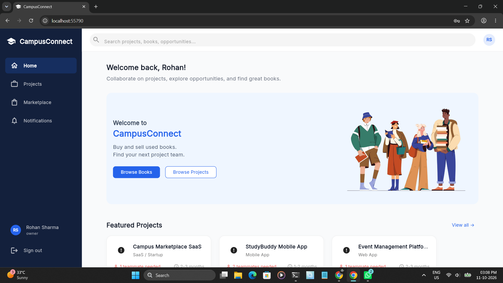
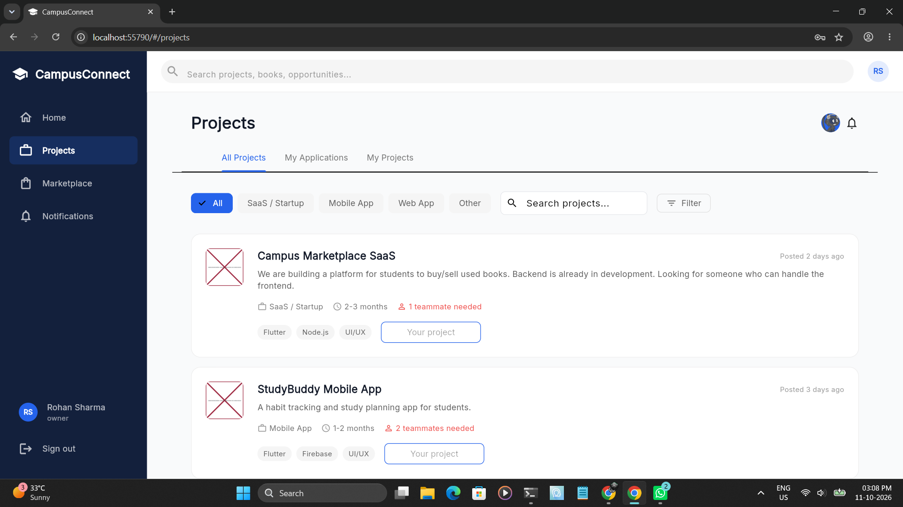
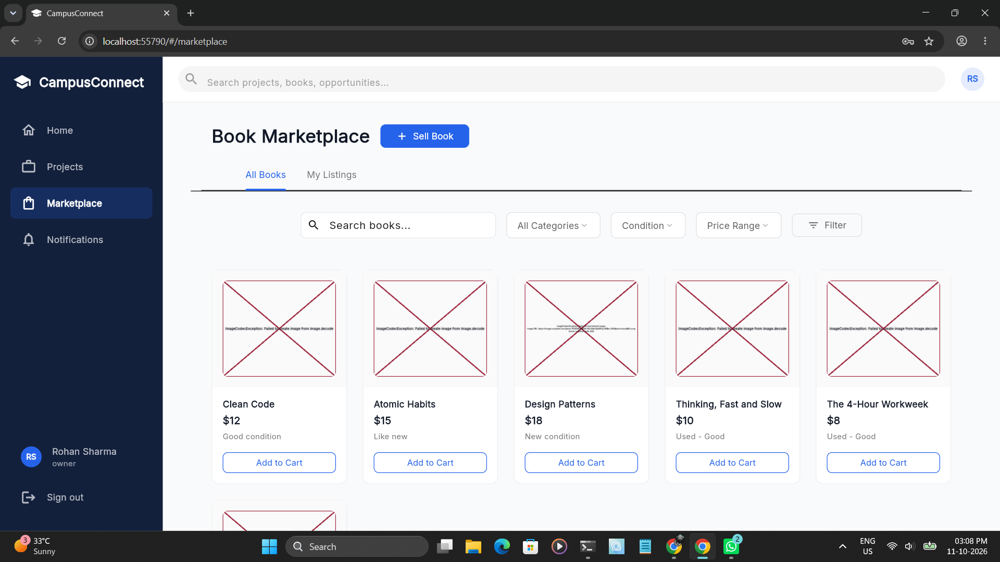
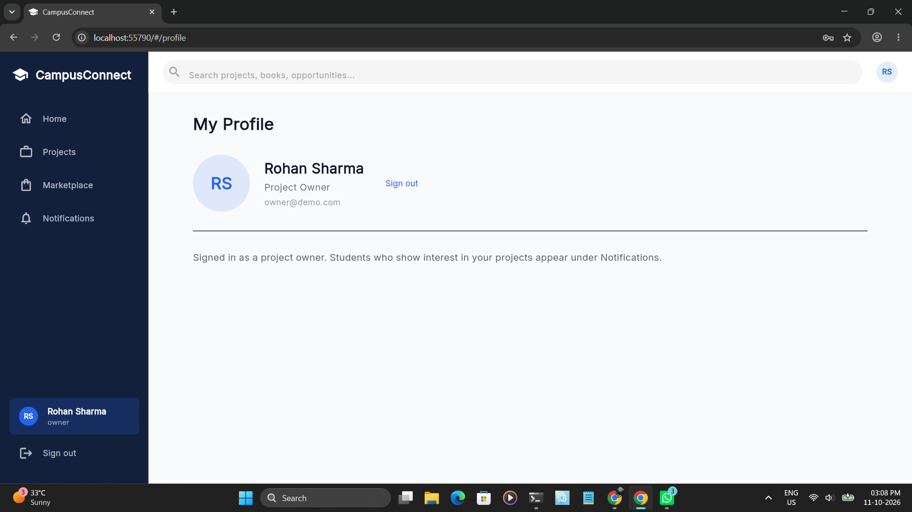

# 🎓 CampusConnect

### Connect. Collaborate. Create.

**CampusConnect** is a student-focused collaboration platform designed to help students discover exciting projects, find teammates with the right skills, and buy or sell used academic books — all in one place.

Whether you're building your first college project, developing a startup idea, looking for collaborators, or searching for affordable textbooks, CampusConnect helps you connect with the right people and resources.

---

## 📌 About the Project

Finding the right teammates for a project can be difficult. Students often have great ideas but lack the skills, team members, or resources needed to bring them to life. At the same time, students looking for practical experience struggle to discover projects where they can contribute and improve their skills.

CampusConnect aims to bridge this gap by creating a shared platform where students can showcase their skills, discover projects, connect with potential teammates, and exchange used academic books.

## ✨ Key Features

### 🤝 Student Project Collaboration
- **Discover Projects:** Explore projects posted by students across different domains.
- **Find Teammates:** Connect with students who have the skills your project needs.
- **Skill-Based Opportunities:** Discover projects that match your technical skills, interests, and learning goals.
- **Project Listings:** View project descriptions, categories, required technologies, timelines, and open team positions.
- **Team Recruitment:** Students working on a project can publish their requirements and find suitable collaborators.
- **Project Applications:** Explore opportunities to join projects and keep track of your applications.

### 📚 Student Book Marketplace
- **Buy Used Books:** Discover affordable academic books listed by other students.
- **Sell Your Books:** Give your used textbooks a second life by listing them for other students.
- **Student-to-Student Exchange:** Make it easier for students to find the learning resources they need.

### 🏫 Student-Friendly Dashboard
- **Personalized Home:** Get an overview of featured projects and useful opportunities.
- **Project Categories:** Browse projects by type, including SaaS / Startup, Mobile App, Web App, and Other.
- **Search and Filters:** Find relevant projects without scrolling through unrelated listings.
- **Application Management:** Access your project applications and your own project listings through dedicated sections.
- **Notifications:** Stay informed about relevant activity and updates.

*Feature availability depends on the current implementation. Some capabilities may still be under development.*

---

## 🎯 Our Mission

To make student collaboration easier, more accessible, and more productive by helping students find the right teammates, gain practical experience, turn ideas into real projects, and access affordable learning resources.

## 👥 Who Is CampusConnect For?

- **Student Developers:** Find projects where you can apply your programming skills.
- **Aspiring Founders:** Find collaborators for SaaS products, startups, and new ideas.
- **Designers:** Join teams looking for UI/UX designers and creative contributors.
- **Students Seeking Experience:** Contribute to real projects, learn new technologies, and build your portfolio.
- **Book Buyers and Sellers:** Find affordable academic books or sell books you no longer need.

## 💡 The Problem We Want to Solve

Imagine you have an idea for a mobile application, but you need a UI/UX designer and a backend developer.

You could search through multiple groups, send messages to strangers, and hope someone is interested.

With CampusConnect, the goal is simple:

1. Post your project and explain your idea.
2. Specify the skills and number of teammates you need.
3. Let interested students discover your project.
4. Find collaborators whose skills and interests match your requirements.
5. Start building something together.

The same platform also enables students to discover projects they want to contribute to, rather than waiting for someone to recruit them.

---

## 🖥️ Interface Preview

The current interface includes a student dashboard, project discovery page, category filters, search functionality, and a navigation menu for the marketplace and notifications.


```text
CampusConnect/
├── README.md
├── screenshots
├── Campus Connect/
│   ├── build
│   └── web
└── ...
```


*Home dashboard*



*Project discovery and teammate recruitment*



*Book Marketplace*



*User Profile*




## 🛠️ Technology Stack

- **Framework:** Flutter
- **Programming Language:** Dart
- **Platform:** Web (Chrome)
- **UI:** Flutter Material Design

## 🚀 Getting Started

Follow these steps to run CampusConnect locally.

### Prerequisites

Make sure you have the following installed:

- [Flutter SDK](https://docs.flutter.dev/get-started/install)
- [Google Chrome](https://www.google.com/chrome/)
- [Git](https://git-scm.com/downloads)

Verify your Flutter installation:

```bash
flutter doctor
```

### Installation

**1. Clone the repository**

```bash
git clone https://github.com/YOUR-USERNAME/CampusConnect.git
```

**2. Navigate to the project directory**

```bash
cd CampusConnect
```

**3. Install dependencies**

```bash
flutter pub get
```

**4. Run CampusConnect in Chrome**

```bash
flutter run -d chrome
```

Flutter will build and launch the application in Google Chrome.

### 🌐 Run on Other Platforms

CampusConnect can potentially be adapted for other Flutter-supported platforms, depending on the project's configuration.

To check available devices:

```bash
flutter devices
```

### 🏗️ Build for Web

To generate a production-ready web build:

```bash
flutter build web
```

The generated web files will be available in:

```text
build/web/
```

You can deploy this directory to a compatible static web hosting service.

### ⚠️ Troubleshooting

- **Chrome not detected:** Ensure Chrome is installed and recognized by Flutter.
- **Dependencies fail to resolve:** Run `flutter pub get` again and check your internet connection.
- **Web support is disabled:** Run `flutter config --enable-web`, then check available devices with `flutter devices`.
- **Application fails to start:** Check the terminal output for errors and verify the project's dependencies and configuration.


## 🗺️ Future Roadmap

Potential improvements planned for CampusConnect include:

- [ ] Skill-based teammate recommendations
- [ ] Student profiles with skills, interests, and portfolios
- [ ] Project applications and recruitment management
- [ ] Direct messaging between students
- [ ] Advanced project search and filtering
- [ ] Book listings with prices, conditions, and subject categories
- [ ] Contact and exchange coordination between book buyers and sellers
- [ ] University or college-based communities
- [ ] Project progress updates and team collaboration tools
- [ ] Responsive mobile-friendly interface

The roadmap will evolve based on implementation progress and student feedback.

## 🤝 Contributing

Contributions, ideas, and feedback are welcome!

If you want to contribute:

1. Fork the repository.
2. Create a feature branch.
3. Make your changes.
4. Test your implementation.
5. Submit a pull request describing your improvements.

For significant changes, consider opening an issue first to discuss the proposed feature.

## 🔒 Privacy and Security

CampusConnect is intended to be a student-friendly platform. Future development should prioritize secure authentication, protection of student information, input validation, and safe interactions between users.


## 🌱 Vision

CampusConnect aims to make it easier for students to move from learning individually to building together.

A developer should be able to find a designer. A student with an idea should be able to find a team. A student looking for experience should be able to discover an opportunity. And a textbook that one student no longer needs should help another student learn.

**One campus. Countless ideas. Better connections.**

---

**CampusConnect — Built for students, powered by collaboration.**
